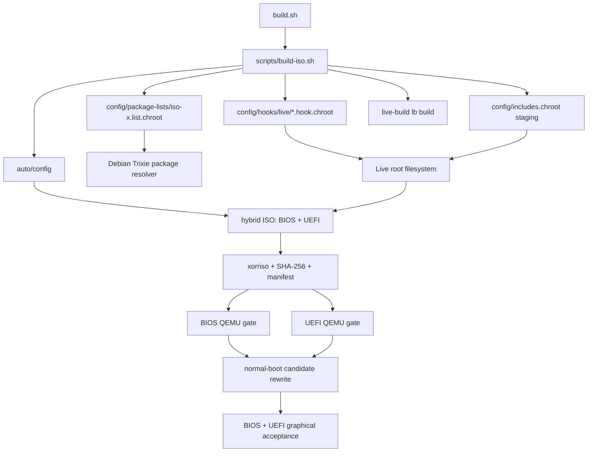

# ISO-X Dependency Graph

## Evidence Context

Graph is based on the clean tracked HEAD `22b9fc116ee278be22c5bbe30782f980100d85a1` plus locally reviewed edits in this audit. Filesystem/package edges are labeled as source-staged until an ISO build proves the final rootfs. CI run `40216891064` has source-check success; build was in progress at audit time.

## Build and Image Assembly



`build.sh` invokes the guarded build script. The build stages source files, system configuration, package manifest and hooks; live-build resolves packages and produces the image. The CI workflow separately validates structure/hash, boots diagnostic candidate under BIOS and UEFI, rewrites a normal-boot candidate, then performs graphical acceptance. A successful source check or boot diagnostic gate alone does not prove the normal image's desktop.

## Session and Desktop

```mermaid
flowchart LR
  lightdm[LightDM + PAM] --> openbox[Openbox session]
  hook[0300 services hook] --> lightdm
  openbox --> autostart[generated /etc/skel/.config/openbox/autostart]
  autostart --> pcmanfm[PCManFM desktop + icons]
  autostart --> tint2[tint2 panel + launchers + task list]
  autostart --> keyboard[setxkbmap ara,us]
  autostart --> app[GTK ISO-X shell]
  desktop[desktop/openbox-rc.xml] --> openbox
  menu[desktop/openbox-menu.xml] --> openbox
  look[scripts/apply-windows-look.sh] --> skel[/etc/skel settings]
  look --> libfm[~/.config/libfm/libfm.conf]
  libfm --> touch[PCManFM one-click activation]
  look --> gtk2[~/.gtkrc-2.0]
  look --> gtk3[~/.config/gtk-3.0/gtk.css]
  themehook[0500 menu contrast hook] --> obtheme[Clearlooks themerc]
  obtheme --> menu
```

The session hook configures LightDM autologin and Openbox; the build generates the user's autostart. PCManFM owns desktop icons, tint2 owns its task list/launcher, and Openbox owns native decorations, window gestures, and root menu. `apply-windows-look.sh` targets `/etc/skel`; this is a source-to-image contract, not proof that existing user homes are migrated.

## Feature Call Paths

| User action | Connected call path | External effect | Result verification |
|---|---|---|---|
| Open GTK shell | `LightDM -> Openbox autostart -> /usr/local/bin/iso-x -> /usr/share/iso-x/iso_x_gtk.py -> ISOXGtk` | GTK process and native Openbox-managed window | `test_gtk_window_runtime.py`; CI run `40210339242` passed window controls/focus/resize. |
| Open desktop launcher | `PCManFM -> .desktop Exec -> installed executable` | Launches application by desktop entry | Build generates entries; actual per-entry launch not exhaustively tested. |
| Single tap desktop icon | `libfm config single_click=1 -> PCManFM activation -> .desktop Exec` | Launches selected desktop item on one click | Temp-HOME config assertion passed; real touch device not tested. |
| Snap active window | `Super+Left/Right -> Openbox Execute -> isox-snap-window.sh -> xrandr + wmctrl` | Read output geometry and resize/move active window | Script/source trace confirmed; missing `x11-xserver-utils` identified and added locally; new image pending. |
| Secure Vault menu | `Openbox menu -> xterm -e isox-vault -> secure-vault.sh -> secure-vault.py -> prompt -> ask_secret -> encrypt/decrypt -> OpenSSL+tar` | Encrypted archive or verified extraction | No-argument baseline produced usage/exit 2; interactive routing test plus real OpenSSL round-trip passed after local fix. |
| Install APT app | `AppCard clicked -> _manage_app -> confirmation -> _begin_operation thread -> backend.install_apt -> apt-cache revalidation -> pkexec /usr/bin/apt-get -> is_installed -> GLib callback/status` | Privileged package installation | Backend fake-runner tests validate argv/result; missing `pkexec` package found and added locally; real package transaction not run. |
| Install Flatpak app | `AppCard -> confirmation -> worker -> install_flatpak validates remote listing -> flatpak install --user -> refresh catalog` | User-scoped application install | Fake runner tests validate identity/remote; no real remote/network install. |
| Switch keyboard | `tint2 ExecP click / GTK callback -> isox_keyboard -> XKB/libX11 + setxkbmap -> active group check` | Change current XKB group | CI GTK test verifies Arabic/English typing in GTK and xterm. |
| Copy/move/delete | `GTK toolbar -> selection validation + confirmation -> worker thread -> copy/move/remove -> GLib completion` | Filesystem mutation for selected paths | Source contracts and code inspection; not all file-operation scenarios exercised in Xvfb. |
| ZRAM | `build symlink -> systemd isox-zram.service -> isox-zram-setup -> zramctl/modprobe/mkswap/swapon/sysctl` | Kernel zram swap | Staged and syntax-reviewed; no measured guest zram run in this audit. |
| Preload | `skel user timer -> user service -> isox-preload -> opt-in DB check -> procfs/page cache` | Optional cache warmup | Source path only; not performance-tested. |
| QEMU readiness | `workflow BIOS/UEFI job -> qemu-acceptance.sh -> qemu-runner.py -> QMP/serial/screenshots/guest nonce` | Boot status and evidence artifacts | Fake tests locally; actual CI boot/desktop evidence available on completed run `40210339242`, not yet for this dirty tree. |

## Trust Boundaries

- Openbox XML commands run as the logged-in user. Privileged package changes are routed through `pkexec`; shell strings are not built from package IDs in the backend.
- The App Center reports package operation success from subprocess return codes and re-queries installed state in the UI layer.
- Vault passphrases are read from a TTY and sent to OpenSSL via an inherited fd; no password is placed in argv. Interactive menu flow now collects paths before asking for the passphrase.
- CI and local unit fakes establish argv/contract behavior but do not prove repository availability, user authentication, or physical hardware support.