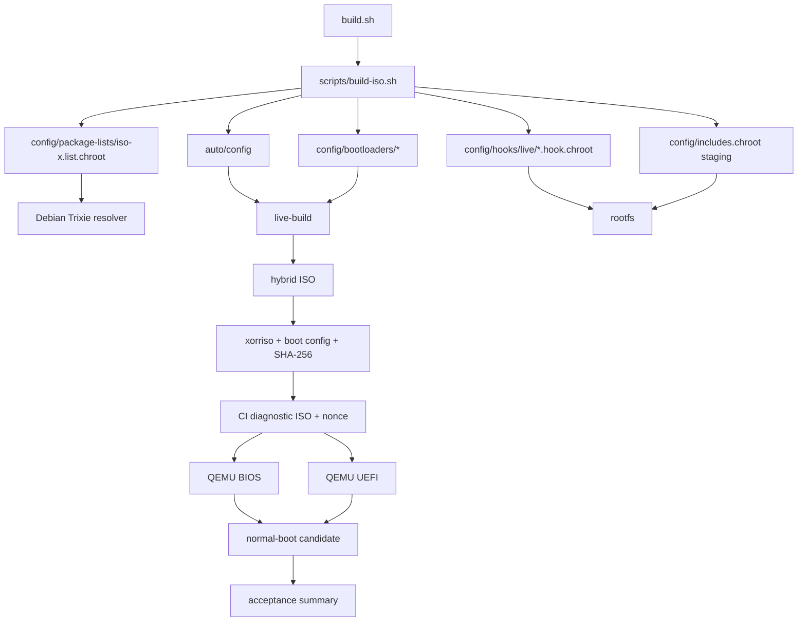
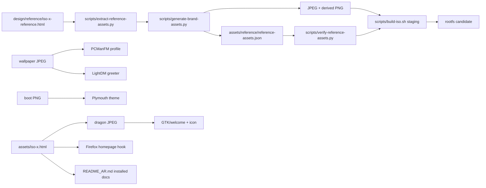
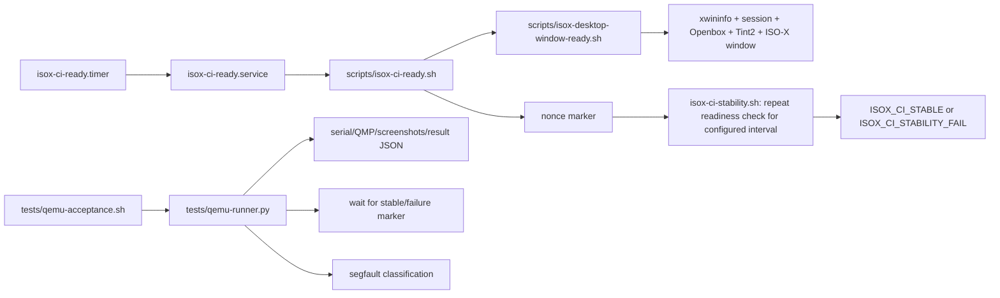

# ISO-X Dependency Graph — current audited paths

## Snapshot

This graph is current to the source audit begun on `b15647056fc609fba9e2d26748864dcc5ec50487` (2026-11-06), plus uncommitted source edits described below. CI `42221229398` completed successfully on `b156470`; it predates the local edits and is not their runtime evidence. Details and limits are in `FILE_BY_FILE_AUDIT_AR.md`, `FILE_RELATIONSHIP_MATRIX_AR.md`, and `REQUIREMENTS_TRACEABILITY_AR.md`.

## Build and acceptance



The workflow must not promote unless source-check, build validation and both firmware gates succeed. A cancelled/skipped BIOS gate is not PASS. Run `42221229398` completed source/build/BIOS/UEFI/promote/acceptance-summary successfully on the base commit; it did not include this audit's later edits.

## Brand resources and browser entry



The large design HTML is a candidate copied from `iso-x 22.html`, not verified as the named user attachment. The small `assets/iso-x.html` is a local Firefox welcome/search page and does not replace the GTK desktop shell. The seven obsolete `assets/iso-x-*` artwork files were removed after no runtime/build consumer was found. All remaining local page URLs now have source-contract assertions; actual ISO file hashes remain unverified after the current edits.

## Desktop session ownership

```mermaid
flowchart LR
  lightdm[LightDM autologin: user] --> openbox[Openbox session]
  openbox --> autostart[/etc/skel/.config/openbox/autostart]
  autostart --> pcmanfm[PCManFM desktop + wallpaper]
  autostart --> tint2[Tint2 panel/task list]
  autostart --> gtk[ISO-X GTK shell]
  autostart --> helpers[network/audio/power/polkit/keyboard applets]
  rc[desktop/openbox-rc.xml] --> openbox
  menu[desktop/openbox-menu.xml] --> openbox
  config[desktop/tint2rc] --> tint2
  look[scripts/apply-windows-look.sh] --> skel[/etc/skel theme/profile]
  skel --> pcmanfm
  skel --> gtk
```

Ownership is intentionally distinct: Openbox manages native windows and menu, Tint2 is the real panel/task list, PCManFM draws desktop icons/wallpaper, and GTK provides ISO-X application windows. There is no HTML taskbar in the current build. Current HTML UI acceptance is still missing.

## Runtime services and launch paths

```mermaid
flowchart TD
  openbox --> gtkEntry[/usr/local/bin/iso-x]
  gtkEntry --> gtkSource[/usr/share/iso-x/iso_x_gtk.py]
  gtkSource --> appcenter[isox_appcenter.py]
  appcenter --> backend[isox_store_backend.py]
  backend --> polkit[pkexec / apt-get / Flatpak]
  menu[Openbox menu] --> desktops[Desktop Entries / commands]
  desktops --> userApps[Firefox ESR, Thunar, terminal, settings...]
  openbox --> preloadUser[isox-preload.timer]
  preloadUser --> preload[isox-preload.py]
  boot[systemd boot] --> zram[isox-zram.service]
  zram --> zramScript[/usr/local/sbin/isox-zram-setup]
```

Package availability and source-level argv validation do not prove a real package transaction or hardware service.

## CI readiness



`wmctrl` was removed from the readiness probe because the old probe coincided with its crashes; it remains a package/feature dependency elsewhere. The historic internal causes of `wmctrl` and Tint2 crashes remain unknown. The source now monitors Openbox, Tint2, and the ISO-X window after readiness and QEMU waits for the stable/failure marker. Regression tests cover the marker protocol; no guest run of this new path has completed yet.